# port-sync

Keeps qBittorrent's port synced to Proton VPN

<picture>
  <source media="(prefers-color-scheme: dark)" srcset="docs/assets/panel-dark.svg">
  
</picture>

```powershell
irm https://raw.githubusercontent.com/Real-Fruit-Snacks/port-sync/main/install.ps1 | iex
```

- **Automatic port sync:** Reads Proton VPN's Windows log every 15 seconds and updates qBittorrent's listening port via the local Web UI API (disabling random port and UPnP).
- **Tray app, no admin required:** Runs as your normal Windows account, starts at sign-in, and encrypts the Web UI password with Windows DPAPI.
- **Offline ready:** Every [release](https://github.com/Real-Fruit-Snacks/port-sync/releases/latest) ships an offline zip (`port-sync-<version>-offline.zip`) with `port-sync.exe`, installer, and docs.
- **Local-first:** Pure Rust binary talking only to `127.0.0.1` and local log files — zero telemetry.

## Documentation

- [Project Page](https://real-fruit-snacks.github.io/port-sync/)
- [Proton VPN & qBittorrent Setup Guide](docs/setup-guide.md)
- [Usage, `sync.log`, Settings & Known Issues](docs/USAGE.md)
- [Changelog](CHANGELOG.md) · [Contributing](CONTRIBUTING.md) · [Security](SECURITY.md)

## License

[MIT](LICENSE). Not affiliated with Proton AG or the qBittorrent project.
