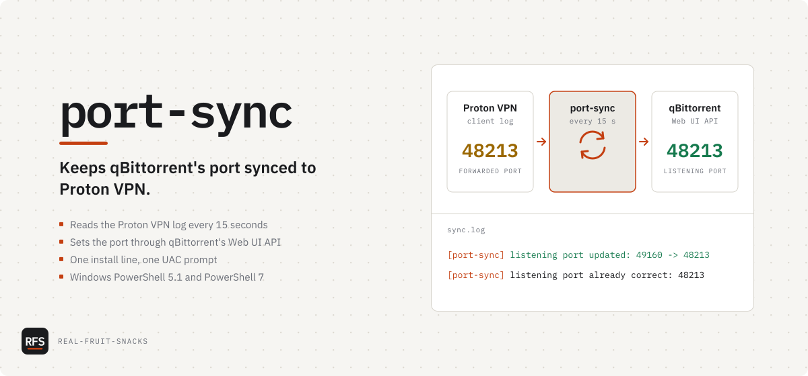

# port-sync

Keeps qBittorrent's port synced to Proton VPN

<picture>
  <source media="(prefers-color-scheme: dark)" srcset="docs/assets/cover-dark.svg">
  
</picture>

```powershell
irm https://raw.githubusercontent.com/Real-Fruit-Snacks/port-sync/main/install.ps1 | iex
```

Run it in a normal PowerShell window as the Windows account you torrent with. It generates a Web UI password, tells you where to paste it in qBittorrent, does one test sync, then registers a scheduled task that runs at sign-in. One UAC prompt, for the task.

Proton VPN hands out a new forwarded port on most reconnects. Until qBittorrent listens on that port, peers can't connect in, so downloads slow down and seeding mostly stops. On Linux the Proton app writes the port to a file; the Windows app only writes it to its own log, so port-sync reads the log every 15 seconds and sets the port through qBittorrent's Web UI API. It assumes the VPN and qBittorrent are already set up so torrent traffic can't leave outside the tunnel; [docs/setup-guide.md](docs/setup-guide.md) is that setup, step by step.

Coming from `proton-qbit-port-sync` 1.x: run the same install line. It keeps your password file, replaces the old task, and moves to `%LOCALAPPDATA%\port-sync`.

## What's in it

| Command | Does |
|---|---|
| `install.ps1` | Installs or updates: password file, script, sign-in task, one test run |
| `install.ps1 -Uninstall` | Removes the task and `%LOCALAPPDATA%\port-sync`; qBittorrent keeps its last port |
| `port-sync.ps1` | The loop: reads the Proton log, sets qBittorrent's listening port, re-checks every 60 s |
| `port-sync.ps1 -Once` | One cycle; exit 0 if qBittorrent has the forwarded port, 1 if not |
| `port-sync.ps1 -Version` | Prints the version |
| [`docs/setup-guide.md`](docs/setup-guide.md) | Kill switch, adapter binding, port forwarding, leak test, troubleshooting |

```powershell
Get-Content "$env:LOCALAPPDATA\port-sync\sync.log" -Wait -Tail 20                  # watch it
powershell -NoProfile -ExecutionPolicy Bypass -File "$env:LOCALAPPDATA\port-sync\port-sync.ps1" -Once
Stop-ScheduledTask port-sync; Start-ScheduledTask port-sync                         # restart
& ([scriptblock]::Create((irm https://raw.githubusercontent.com/Real-Fruit-Snacks/port-sync/main/install.ps1))) -Uninstall   # remove
```

## Tested on

- Ubuntu 24.04 · PowerShell 7.4.6 · qbittorrent-nox 4.6.3: the Pester suite, including the sync against a real Web UI, with simulated Proton log lines
- Windows Server 2022 (GitHub `windows-latest`) · Windows PowerShell 5.1 and PowerShell 7: unit tests, and the installer against a real Task Scheduler (in [CI](.github/workflows/ci.yml))
- *Not* tested: the Proton VPN app's real log on a real Windows 10/11 desktop, and qBittorrent 5.x. If you run either, an issue saying which versions worked or didn't is the most useful thing you can send.

## Known issues

- Proton doesn't document the `Port pair 54692->54692` log line. The path and wording come from two community tools that rely on it ([qbit-proton-port](https://github.com/EudesRobin/qbit-proton-port), [Auto-Port-Sync](https://github.com/Jaques-and-sons/ProtonVPN-qBittorrent-Auto-Port-Sync)). If an app update changes it, `sync.log` says `no forwarded port in the Proton VPN log yet` and nothing else breaks.
- A console window can flash at sign-in. `-WindowStyle Hidden` hides it after `powershell.exe` has started, not before.
- The password file is DPAPI-encrypted to the account that created it. Run the installer as the account you torrent with, not as a separate admin account.
- qBittorrent has to be running to receive the port. A change made while it's closed lands within 60 s of opening it.
- After a rejected login the script waits for the password file to change, or 30 minutes, before trying again, because qBittorrent bans an address after 5 failures in a row.

## Configuration

Defaults fit the setup guide: Web UI on `127.0.0.1:8080`, user `admin`, WireGuard adapter `ProtonVPN`.

| Parameter | Default | Purpose |
|---|---|---|
| `-QbitUrl` | `http://127.0.0.1:8080` | qBittorrent Web UI address |
| `-QbitUser` | `admin` | Web UI username |
| `-ProtonLogs` | `%LOCALAPPDATA%\Proton\Proton VPN\Logs` | Folder with `client-logs.txt` |
| `-Adapter` | `ProtonVPN` | Adapter that must be up before syncing. `ProtonVPN TUN` for OpenVPN, `''` to skip the check |
| `-StateDir` | `%LOCALAPPDATA%\port-sync` | Password file and `sync.log` |
| `-IntervalSec` | `15` | How often to read the Proton log |
| `-RecheckSec` | `60` | How often to re-read qBittorrent's port when Proton's hasn't changed |

To change one for the scheduled task, in an admin PowerShell (OpenVPN as the example):

```powershell
$t = Get-ScheduledTask port-sync
$t.Actions[0].Arguments += " -Adapter 'ProtonVPN TUN'"
Set-ScheduledTask -InputObject $t
Stop-ScheduledTask port-sync; Start-ScheduledTask port-sync
```

Re-running the installer resets the task to the defaults.

## License

[MIT](LICENSE). Not affiliated with Proton AG or the qBittorrent project. [Changelog](CHANGELOG.md) · [Security](SECURITY.md) · [Contributing](CONTRIBUTING.md)
